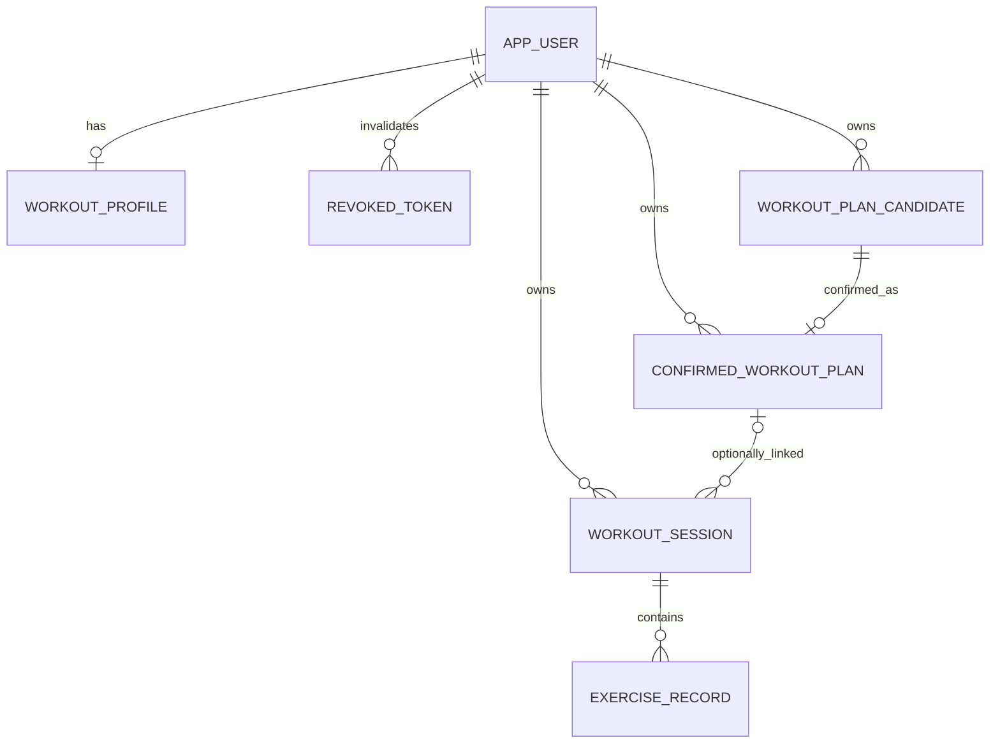

# 포트폴리오 MVP 최소 ERD

* 작성일: 2026-10-28
* 범위: [최소 도메인 모델](portfolio-mvp-domain-model.md)의 관계 설계
* 상태: AUTH / USER는 2026-10-30 구현 대상으로 구체화. PLAN·SESSION·RECORD는 설계만 유지

## 최소 키와 데이터

| 논리 테이블 | 키와 관계 | 데이터 |
| --- | --- | --- |
| app_user | id PK, email UNIQUE | password_hash, nickname, timezone, created_at |
| workout_profile | user_id PK/FK → app_user | goal, experience_level, preferred_types, equipment |
| workout_plan_candidate | id PK, user_id FK → app_user | 생성 조건, 현재 내용, 최초 추천 이유, 생성 시각, 조작 가능 여부 |
| confirmed_workout_plan | id PK, user_id FK → app_user, candidate_id UNIQUE FK | 확정 시점 내용·시간 스냅샷, confirmed_at |
| workout_session | id PK, user_id FK → app_user, confirmed_plan_id NULL 허용 FK | started_at, ended_at NULL 허용, 진행·종료 정보 |
| exercise_record | id PK, session_id FK → workout_session | 운동 유형별 실제 수행값, performed_at |

## 구현 시 보장할 제약

* confirmed_workout_plan.candidate_id의 유일성으로 후보당 최대 한 번 확정을 보장하고 반복 요청은 실패 처리한다(FR-PLAN-005).
* 후보·계획·세션 연결 시 소유자가 동일한지 검증한다. FK만으로 사용자 소유권 검사가 대체되지 않는다.
* 사용자당 진행 중 세션 하나, 조작 가능한 현재 후보 하나를 동시 요청에서도 보장할 DB 제약·트랜잭션을 설계한다(US-04-05, FR-PLAN-007). 실제 인덱스와 상태 열 표현은 명세 보완 후 결정한다.
* 후보·확정 계획·실제 기록은 별개 데이터다. 프로필 변경이 기존 후보·계획을 소급 변경하지 않는다.
* 시각은 UTC 의미의 PostgreSQL timestamptz로 저장하고 사용자 시간대는 별도 필드로 관리한다.
* 빈 종료 세션은 ended_at과 유효한 기록 유무로 구분할 수 있어야 한다. 저장 상태 이름과 삭제 후 재분류 정책은 보류한다.
* 확정 계획을 여러 세션에 연결할 수 있는지는 정책 미정이다. 다이어그램의 역방향 다중성은 해당 재사용을 승인한 의미가 아니다.

식별자 자료형, 계획 항목·장비 등의 정규화/JSONB 선택, 원본 후보·수정 이력·추천 이유의 확정 후 보존, 기록 삭제 방식과 초안 테이블은 이 단계에서 확정하지 않는다. 해당 정책을 정한 뒤 마이그레이션으로 관리하며 Hibernate 자동 스키마 생성은 사용하지 않는다.

## AUTH / USER 물리 스키마 — 2026-10-30

위 미결정 사항 중 AUTH / USER의 식별자와 프로필 표현만 아래와 같이 구체화한다. PLAN 관련 키·데이터·정책은 변경하지 않는다.

| 테이블 | 열·제약 |
| --- | --- |
| app_user | id UUID PK, email varchar(254) NOT NULL UNIQUE·소문자 CHECK, password_hash varchar(100) NOT NULL, nickname varchar(20) NOT NULL·2~20자 CHECK, timezone varchar(64) NULL, created_at timestamptz NOT NULL |
| workout_profile | user_id UUID PK/FK, goal·experience_level varchar(32) NOT NULL 허용값 CHECK, preferred_types·equipment text[] NOT NULL |
| revoked_token | jti UUID PK, user_id UUID NOT NULL FK, expires_at·revoked_at timestamptz NOT NULL, expires_at 정리용 인덱스 |

* 프로필의 text[]는 순서에 의미를 부여하지 않는 작은 선택값 목록이다. DB CHECK로 1차 허용값·중복 금지·빈 배열 금지·null 원소 금지·장비 없음 단독 선택을 보장한다. 요청에서도 같은 규칙을 검증한다.
* Flyway `V1__auth_user.sql`이 위 세 테이블만 생성한다. Hibernate `ddl-auto: validate`로 매핑 불일치를 발견하며 기존 DB를 자동 삭제·초기화하거나 Flyway baseline을 자동 지정하지 않는다.
* RevokedToken은 재시작과 독립된 PostgreSQL 데이터다. 만료 시각 이전에는 보존하고 만료된 행만 정리한다.

## 추적 근거

* FR-USER-003~004, FR-PLAN-001~007: [Functional Requirements](../requirements/functional-requirements.md)
* US-04-01~06, US-05-02~05, US-06-01~07, US-07-01~03: [User Stories](../requirements/user-stories.md)
* [ADR-002](adr/ADR-002-workout-session-and-exercise-record-separation.md), [ADR-003](adr/ADR-003-workout-plan-lifecycle.md), [ADR-004](adr/ADR-004-workout-plan-candidate-policy.md)
